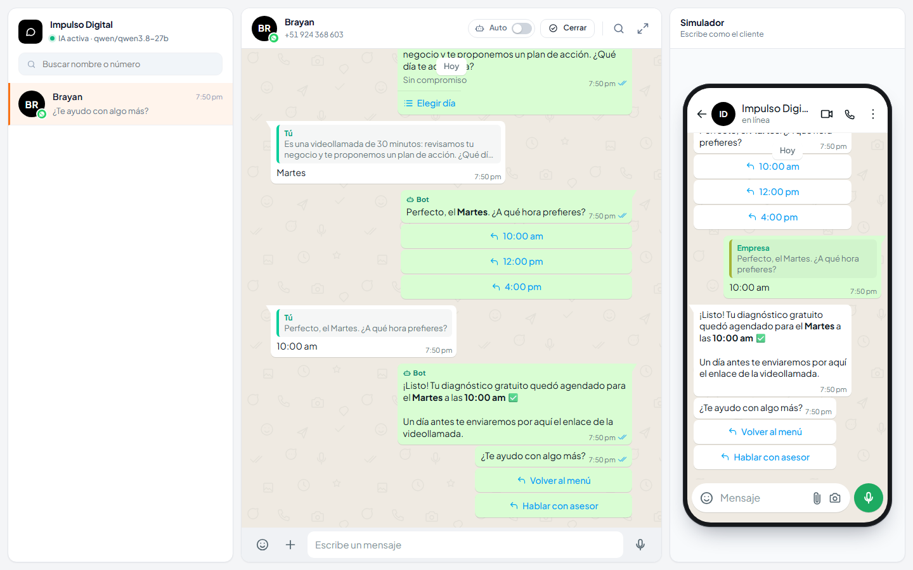
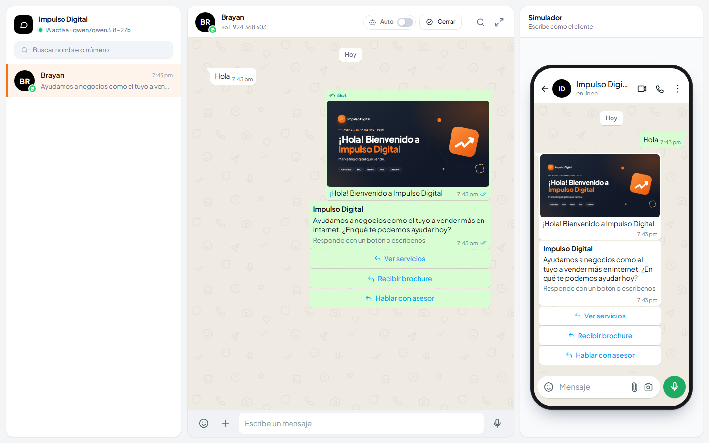
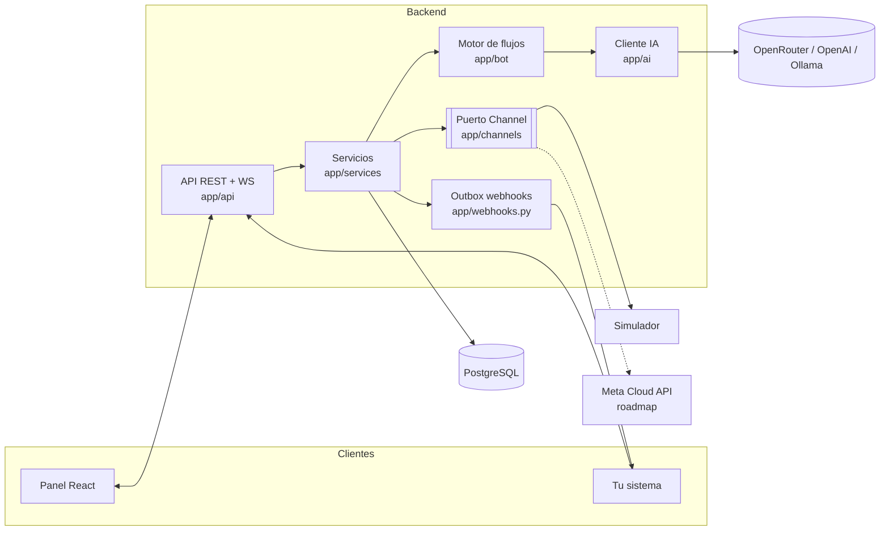

# Wabot

Wabot es un microservicio de chatbot para WhatsApp. Atiende a tus clientes con flujos que defines en
un JSON y, si quieres, con un modelo de IA; cuando hace falta una persona, un asesor toma la
conversación desde un panel que se ve y se usa como WhatsApp Web. Tu sistema (CRM, ERP, tienda) se
integra por API REST y webhooks firmados.

Trae un **simulador de teléfono**: puedes probar todo —flujos, IA, botones, listas, archivos,
estados de entrega— sin cuenta de Meta ni número real. El adaptador para la API oficial de WhatsApp
Cloud está en el roadmap y se enchufa en el mismo puerto que usa el simulador.

| Panel del asesor | Simulador |
|---|---|
|  |  |

## Qué hace

- **Bandeja tipo WhatsApp Web**: conversaciones, no leídos, búsqueda, burbujas con ticks
  (enviado, entregado, leído), respuestas citadas, adjuntos y vista previa.
- **Manual / Auto por conversación**: en Auto responde el bot; cuando un asesor escribe, pasa a
  Manual y el bot se calla.
- **Flujos en JSON** (`backend/config/flow.json`): menús con botones o listas, palabras clave,
  derivación a asesor. Sin editor visual todavía.
- **IA opcional** con cualquier API compatible con OpenAI. Conoce tu negocio por
  `config/prompt.md` y `config/knowledge.md`, y deriva a un humano cuando no sabe.
- **Todos los tipos de mensaje de WhatsApp** con los límites reales de Meta: texto, imagen, video,
  audio, documento, sticker, ubicación, botones, listas, botón con URL y plantillas.
- **Ventana de 24 h** aplicada igual que en WhatsApp: fuera de ella solo salen plantillas.
- **API REST + WebSocket** documentada en [`docs/api.md`](docs/api.md) y Swagger en `/docs`.
- **Webhooks salientes** con firma HMAC-SHA256 y reintentos (patrón outbox: no se pierden eventos si
  tu sistema está caído).

## Inicio rápido con Docker

```bash
git clone https://github.com/<tu-usuario>/wabot.git
cd wabot
cp backend/.env.example backend/.env
docker compose up -d --build
```

- Panel: <http://localhost:5173>
- API y Swagger: <http://localhost:8000/docs>
- Salud: <http://localhost:8000/health>

Abre el panel, ve al simulador y escribe "hola".

Para IA local con Ollama:

```bash
docker compose --profile ia-local up -d
docker compose exec ollama ollama pull llama3.1
```

## Desarrollo local

Requisitos: Python 3.12, Node 22 y un PostgreSQL 16 (puedes levantar solo la BD con
`docker compose up -d db`).

```bash
# Backend
cd backend
python -m venv .venv
source .venv/bin/activate            # Windows: .venv\Scripts\activate
pip install -e ".[dev]"
cp .env.example .env
alembic upgrade head
uvicorn app.main:app --reload        # http://localhost:8000

# Frontend (otra terminal)
cd frontend
npm install
npm run dev                          # http://localhost:5173
```

Pruebas y calidad:

```bash
cd backend && ruff check . && ruff format --check . && pytest
cd frontend && npm run lint && npm run typecheck && npm run build
```

## Configurar la IA

Por defecto `AI_PROVIDER=none`: solo responden los flujos. Elige un proveedor en `backend/.env`:

```env
# OpenRouter (cientos de modelos con una sola clave)
AI_PROVIDER=openrouter
AI_API_KEY=sk-or-...
AI_MODEL=openai/gpt-4o-mini

# OpenRouter Perú
AI_PROVIDER=openrouterperu
AI_API_KEY=...
AI_MODEL=openai/gpt-4o-mini

# OpenAI
AI_PROVIDER=openai
AI_API_KEY=sk-...
AI_MODEL=gpt-4o-mini

# Ollama (local, sin clave)
AI_PROVIDER=ollama
AI_MODEL=llama3.1
# en Docker: AI_BASE_URL=http://ollama:11434/v1

# Cualquier otro endpoint compatible con OpenAI
AI_PROVIDER=custom
AI_BASE_URL=https://mi-servidor/v1
AI_API_KEY=...
```

Escribe cómo debe hablar el bot en `backend/config/prompt.md` y lo que debe saber (servicios,
precios, horarios) en `backend/config/knowledge.md`. Detalles en [`docs/ia.md`](docs/ia.md).

## Integrar desde tu sistema

Enviar un mensaje:

```bash
curl -X POST http://localhost:8000/api/v1/messages \
  -H "X-API-Key: $WABOT_API_KEY" \
  -H "Content-Type: application/json" \
  -d '{"to": "+51924368603", "name": "Monica", "type": "text", "body": "Tu pedido salió hoy."}'
```

Botones:

```json
{ "to": "+51924368603", "type": "buttons", "body": "¿Confirmas tu cita del lunes?",
  "buttons": [{ "id": "si", "title": "Sí, confirmo" }, { "id": "no", "title": "Reprogramar" }] }
```

Recibir eventos: define `WEBHOOK_URL` y `WEBHOOK_SECRET`. Cada POST trae
`X-Wabot-Signature: sha256=<hex>`, el HMAC-SHA256 del cuerpo crudo. Verifícalo **antes** de
parsear el JSON.

Node (Express):

```js
import crypto from "node:crypto";
import express from "express";

const app = express();
app.post("/wabot", express.raw({ type: "application/json" }), (req, res) => {
  const expected = "sha256=" + crypto.createHmac("sha256", process.env.WABOT_SECRET)
    .update(req.body).digest("hex");
  const given = req.get("X-Wabot-Signature") ?? "";
  if (given.length !== expected.length ||
      !crypto.timingSafeEqual(Buffer.from(given), Buffer.from(expected))) {
    return res.sendStatus(401);
  }
  const event = JSON.parse(req.body);
  res.sendStatus(204);
});
```

PHP:

```php
<?php
$raw = file_get_contents('php://input');
$expected = 'sha256=' . hash_hmac('sha256', $raw, getenv('WABOT_SECRET'));
$given = $_SERVER['HTTP_X_WABOT_SIGNATURE'] ?? '';
if (!hash_equals($expected, $given)) {
    http_response_code(401);
    exit;
}
$event = json_decode($raw, true);
http_response_code(204);
```

Python (FastAPI):

```python
import hashlib, hmac, os
from fastapi import FastAPI, Header, HTTPException, Request

app = FastAPI()

@app.post("/wabot", status_code=204)
async def wabot(request: Request, x_wabot_signature: str = Header("")):
    raw = await request.body()
    expected = "sha256=" + hmac.new(os.environ["WABOT_SECRET"].encode(), raw, hashlib.sha256).hexdigest()
    if not hmac.compare_digest(expected, x_wabot_signature):
        raise HTTPException(401)
    event = await request.json()
```

Responde 2xx rápido y procesa en segundo plano: si tardas o fallas, Wabot reintenta con espera
exponencial, y la cabecera `X-Wabot-Delivery` te sirve para ignorar duplicados. Más en
[`docs/webhooks.md`](docs/webhooks.md).

## Arquitectura



Arquitectura hexagonal: el núcleo no sabe si habla con el simulador o con Meta. Explicación completa
en [`docs/arquitectura.md`](docs/arquitectura.md).

## Documentación

| Documento | Contenido |
|---|---|
| [`docs/api.md`](docs/api.md) | Contrato de la API, WebSocket y webhooks |
| [`docs/arquitectura.md`](docs/arquitectura.md) | Puertos, flujo de un mensaje, tiempo real, outbox |
| [`docs/base-de-datos.md`](docs/base-de-datos.md) | Diagrama ER, restricciones y por qué existen |
| [`docs/flujos.md`](docs/flujos.md) | Formato de `flow.json` |
| [`docs/ia.md`](docs/ia.md) | Proveedores, prompt, conocimiento, derivación |
| [`docs/webhooks.md`](docs/webhooks.md) | Eventos y verificación de firma |
| [`docs/simulador.md`](docs/simulador.md) | Cómo usar el simulador |
| [`docs/despliegue.md`](docs/despliegue.md) | Variables de entorno y checklist de producción |
| [`docs/conectar-meta.md`](docs/conectar-meta.md) | Plan del adaptador de Meta Cloud API |
| [`docs/decisiones/`](docs/decisiones/) | Registro de decisiones (ADR) |

## Roadmap

- [ ] Adaptador de **Meta WhatsApp Cloud API** (solo API oficial; ver [ADR 0003](docs/decisiones/0003-solo-api-oficial-de-meta.md))
- [ ] **Multiempresa**: varios números y negocios en una instalación
- [ ] **Editor visual de flujos** en el panel
- [ ] Usuarios y roles para asesores
- [ ] Métricas de atención (tiempo de primera respuesta, derivaciones)

## Contribuir

Lee [`CONTRIBUTING.md`](CONTRIBUTING.md). Issues y PR en español o inglés.
