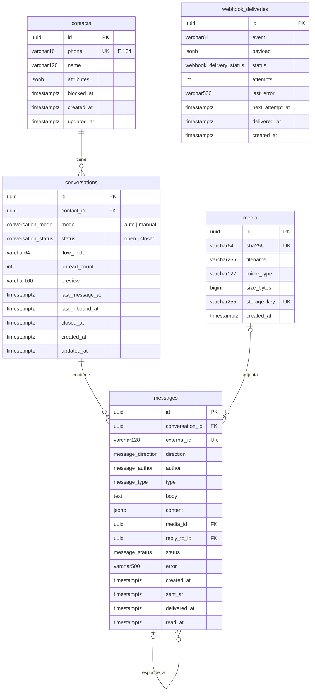

# Base de datos

PostgreSQL 16. Modelos en `backend/app/models.py`, enums en `backend/app/enums.py`, migraciones en
`backend/migrations/` (Alembic). Las pruebas usan SQLite en memoria: por eso algunos tipos e índices
tienen variante (`JSON` → `JSONB` en Postgres, `postgresql_where` / `sqlite_where`) y el CHECK de
teléfono solo se crea en Postgres (`ddl_if`).

## Diagrama



## Convenciones

- Tablas y columnas en **inglés snake_case**, tablas en plural.
- PK `uuid` generada en la app (`uuid.uuid4`): ids no adivinables y creables antes del INSERT.
- Todas las fechas `timestamptz` y en UTC (`utcnow()`; `as_utc()` normaliza lo que viene de SQLite).
- `created_at`/`updated_at` vía el mixin `Timestamped` en tablas que se modifican. `media`,
  `messages` y `webhook_deliveries` solo tienen `created_at` porque su ciclo de vida se registra en
  columnas específicas.
- Enums como **tipos nativos de Postgres** (`pg_enum`) con el *valor* en minúsculas, igual al JSON
  de la API.

## `contacts`

| Columna | Tipo | Por qué |
|---|---|---|
| `phone` | `varchar(16)` `UNIQUE` + CHECK `phone_e164` | El teléfono es la identidad en WhatsApp. Se guarda normalizado en E.164 (`^\+[1-9][0-9]{7,14}$`) para que `+51 924…` y `51924…` no creen dos contactos. |
| `name` | `varchar(120)` default `''` | Nombre del perfil o el que manda tu sistema. Vacío en vez de NULL: una sola forma de "sin nombre". |
| `attributes` | `jsonb` default `{}` | Datos libres que capturan los flujos o tu sistema (email, DNI, interés) sin migrar cada vez. |
| `blocked_at` | `timestamptz` null | Contacto bloqueado: el bot no responde. Fecha en vez de booleano para saber cuándo. |

## `conversations`

| Columna | Por qué |
|---|---|
| `contact_id` FK `ON DELETE CASCADE`, indexada | Borrar un contacto borra su historial (derecho al olvido). |
| `mode` `auto`/`manual` | Quién responde. Un asesor que escribe la pasa a `manual`. |
| `status` `open`/`closed` | Cerrar no borra; un mensaje nuevo del cliente abre otra conversación. |
| `flow_node` | Nodo actual del flujo, para que "1" signifique algo distinto según dónde esté el cliente. |
| `unread_count` CHECK `>= 0` | Contador desnormalizado para la bandeja (evita un `COUNT` por fila). |
| `preview` `varchar(160)` | Último mensaje recortado para la bandeja; evita un JOIN a `messages`. |
| `last_message_at` | Orden de la bandeja. |
| `last_inbound_at` | **Ventana de 24 h**: solo cuenta el último mensaje *del cliente*. La API calcula `window_expires_at` y `window_open` con esto. |
| `closed_at` | CHECK `closed_at_matches_status`: `(status = 'closed') = (closed_at IS NOT NULL)`. Imposible tener una cerrada sin fecha o una abierta con fecha. |

Índices:

- **`uq_conversations_one_open_per_contact`**: `UNIQUE (contact_id) WHERE status = 'open'`. Índice
  único **parcial**: un contacto puede tener muchas conversaciones cerradas pero solo una abierta.
  Si dos mensajes llegan a la vez, el segundo INSERT falla y el servicio reintenta leyendo la
  existente. Una comprobación en Python no basta ante concurrencia.
- **`ix_conversations_inbox`**: `(status, last_message_at DESC)`. Es exactamente la consulta de la
  bandeja: `WHERE status = 'open' ORDER BY last_message_at DESC LIMIT 50`.

## `messages`

| Columna | Por qué |
|---|---|
| `external_id` `UNIQUE` null | Id del mensaje en el canal (`wamid` en Meta). **Idempotencia**: Meta puede entregar el mismo webhook varias veces; el UNIQUE impide duplicarlo. Es NULL mientras un saliente está `pending` (Postgres permite varios NULL en UNIQUE). |
| `direction` + `author` | CHECK `author_matches_direction`: entrante ⇔ autor `contact`. Los salientes son `bot`, `agent` o `api`. |
| `type` | Uno de `MessageType`. Incluye `reply` (respuesta a botón o lista). |
| `body` `text` | Texto o pie de foto. Siempre presente (vacío si no aplica) para búsquedas y vista previa. |
| `content` `jsonb` | Lo específico de cada tipo: `buttons`, `sections`, `url`, `location`, `template`/`params`, `reply_id`/`reply_title`, `header`, `footer`. JSONB porque cada tipo tiene forma distinta y nunca se filtra por esos campos; una tabla por tipo sería ruido. La forma la valida `schemas.py`. |
| `media_id` FK `ON DELETE SET NULL`, indexada | El archivo puede compartirse entre mensajes (dedupe por sha256). |
| `reply_to_id` FK a `messages` `SET NULL` | Respuesta citada. |
| `status` | `received` (entrantes) o `pending → sent → delivered → read` / `failed`. |
| `error` | Motivo del `failed`, visible en el panel. |
| `sent_at`, `delivered_at`, `read_at` | **Un timestamp por estado**: el panel muestra "entregado 10:02, leído 10:15" y se pueden medir tiempos de lectura. El estado nunca retrocede. |

Índice **`ix_messages_timeline`**: `(conversation_id, created_at)`. Sirve al historial paginado
(`?before=<iso>&limit=50`).

## `media`

| Columna | Por qué |
|---|---|
| `sha256` `UNIQUE` | Deduplicación: subir el mismo PDF dos veces devuelve el mismo `Media`. |
| `storage_key` `UNIQUE` | Ruta interna en el almacenamiento; nunca se deriva del nombre que mandó el usuario. |
| `size_bytes` CHECK `> 0` | No hay archivos vacíos. Límite superior por `MAX_UPLOAD_MB` en la app. |
| `mime_type` | Valida qué tipo de mensaje admite el archivo. |

## `webhook_deliveries` (outbox)

| Columna | Por qué |
|---|---|
| `event`, `payload` | Lo que se enviará, congelado en el momento del evento. |
| `status` `pending`/`delivered`/`failed` | Estado de la entrega. |
| `attempts` CHECK `>= 0`, `last_error` | Diagnóstico de reintentos. |
| `next_attempt_at` | Cuándo reintentar (espera exponencial). |
| `delivered_at` | Cuándo respondió 2xx tu sistema. |

Índice parcial **`ix_webhook_deliveries_due`**: `(next_attempt_at) WHERE status = 'pending'`. El
trabajador solo busca lo pendiente; las filas entregadas, que son casi todas, no engordan el índice.
Por qué outbox: [ADR 0006](decisiones/0006-outbox-para-webhooks.md).

## Enums

| Tipo Postgres | Valores |
|---|---|
| `message_type` | text, image, video, audio, document, sticker, location, buttons, list, cta_url, template, reply |
| `message_direction` | inbound, outbound |
| `message_author` | contact, bot, agent, api |
| `message_status` | received, pending, sent, delivered, read, failed |
| `conversation_mode` | auto, manual |
| `conversation_status` | open, closed |
| `webhook_delivery_status` | pending, delivered, failed |

Añadir un valor a un enum de Postgres requiere `ALTER TYPE ... ADD VALUE` en una migración
(Alembic no lo detecta solo). Ver la skill `/modelo-bd`.

## Crear una migración

```bash
cd backend
# 1. Edita app/models.py (y app/enums.py si hace falta)
alembic revision --autogenerate -m "add_contact_email"
# 2. Revisa el archivo generado en migrations/versions/: autogenerate no detecta
#    cambios de enum, CHECK nuevos ni índices parciales correctamente siempre.
alembic upgrade head
alembic downgrade -1 && alembic upgrade head   # comprueba que baja y sube
pytest -q
```

Reglas: nunca edites una migración ya publicada; nombres en inglés snake_case; cada migración con
`downgrade` real.
